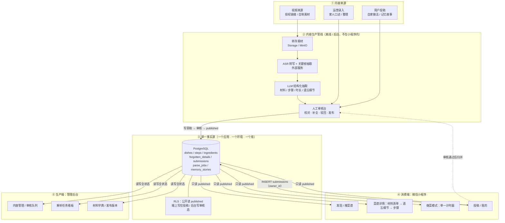
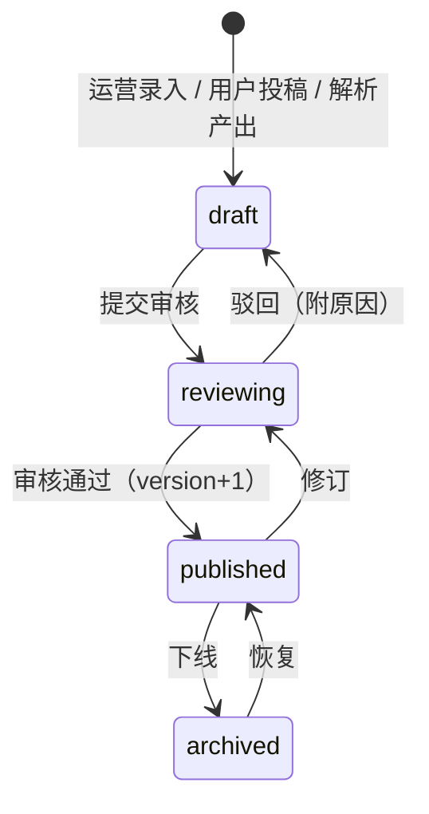
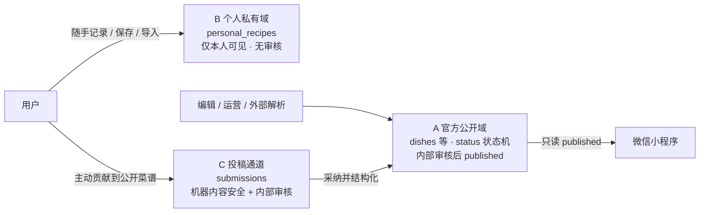

# 「记忆里的美食」产品主体架构方案 v1.0

| 项 | 内容 |
|---|---|
| 日期 | 2026-11-18 |
| 状态 | 架构设计稿（**未实施**） |
| 本轮范围 | 只重新设计主体架构；**不修改** `cooking-timer-prototype.html`，不开通云服务、不建表、不写代码、不发布 |
| 关联文档 | `plans/记忆里的美食-数据模型设计.md`（表结构 / RLS / DDL / 解析输出契约） |
| 现有资产 | `cooking-timer-prototype.html`（12 道菜 / 58 步 / 单一聚焦计时器 / 元气橙蓝配色）、`docs/wxamp-info.md`（小程序凭证） |
| 修订 | **v1.2（2026-11-18 14:32 决策落定）**，见 §12 与 `plans/记忆里的美食-架构修订说明.md` §9；v1.0 / §11 原文完整保留，§12 优先级最高 |

---

## 0. 结论先行

**这个产品的主体不是「计时器小程序」，而是「结构化菜谱内容库 + 内容生产流水线 + 双端（消费端 / 生产端）」。** 计时器要从产品主体降级为消费端里的一个交互模式（下称「做菜模式」）。五条核心判断：

1. **主体换成内容库。** 用户来这里首先是为了「查看菜谱 + 材料清单 + 那些被遗忘的步骤和记忆」，其次才是跟着做。原型的详情页只覆盖了「做」这一层，且是单菜硬编码数据。
2. **管理后台绝对不要做成第二个云应用。** 平台约束是「一个应用 = 一个云服务环境，数据不跨应用共享」。若后台独立成 App，就会出现两套库，「通过数据库同步数据」会退化成定时 ETL 复制，产生双写、冲突、脏数据。正确做法是**单应用、单环境、单库、多端读写**。
3. **视频 → 菜谱不是小程序能力，是离线内容管线。** 托管 LLM 是文本（可选图像）接口，不接受视频文件；平台也不提供采集、下载、ASR、抽帧、任务调度。链路必须是「授权来源 → 转存 → 语音转写 + 关键帧 → LLM 结构化抽取 → 人工审核 → 入库」，跑在后台/离线任务里，不跑在小程序里。
4. **「被遗忘的做菜步骤」必须落成字段，不能只当 slogan。** 独立 `forgotten_details` 表 + 类型枚举（火候 / 焯水 / 去腥 / 静置 / 复炸 / 锅气 / 水量 / 先后顺序 / 家里的小动作）+ 来源 + 置信度，直接决定详情页信息架构、后台审核界面和解析提示词。这是与下厨房/豆果类产品的唯一实质差异。
5. **数据库是唯一事实源。** 小程序只读 `status = published` 的已发布内容；草稿、待审、解析中间态永远不出现在小程序；端上缓存只做展示加速，不得作为数据源（平台明确禁止静默降级到 `localStorage` / mock JSON）。

### 后台形态的关键取舍（需你拍板的一项）

| 方案 | 后台形态 | 数据一致性 | 成本 | 判断 |
|---|---|---|---|---|
| **A（MVP 推荐）** | 同一个应用，直接用平台「数据管理」面板录入/审核，零后台代码 | 强：同库，天然同步 | 最低 | 先把内容模型和产品定位验证掉，不为一个还没验证的产品写后台 |
| **B** | 同一应用内的 Web 管理页 | 强：同库 | 中 | `appType: "miniprogram"` 是创建时一次性写入且不可改，Web 页能否随同应用发布**需要实测确认**，不作为 P0 依赖 |
| **C（不推荐）** | 独立后台应用 + 跨环境同步 | **弱**：两套环境，必须写同步任务 | 高 | 正是要避免的形态。「数据库同步」在这里是负债不是能力 |
| **D（规模化推荐）** | 自托管全栈：统一 Postgres + Node 服务 + MinIO + 独立 Web 后台 | 强：同库 | 运维高 | 内容量、解析任务、多人运营上来后迁此形态；与你已有的服务器 / Docker / MinIO / Gitea+k3s 基础设施吻合 |

**推荐路径：A →（量起来后）D，B 先验证可行性，全程不走 C。** 本方案的数据模型和接口契约按「A 能落地、D 能平滑迁移」设计，不绑定任何一方的专有能力。

---

## 1. 产品重新定义

### 1.1 定位

> 把那些没被写进菜谱、只留在家里人手上和记忆里的做菜细节，结构化地留下来，并能在厨房里用得上。

| 维度 | 定义 |
|---|---|
| 目标用户 | 想复刻「小时候/家里那道菜」的人；愿意贡献自家做法的人 |
| 核心场景 | ① 查一道菜：材料清单 + 完整步骤 + 被忽略的关键细节；② 跟着做：单一计时器引导；③ 投稿：写下自家的做法和记忆 |
| 差异化 | 常规菜谱写「做什么」，本产品补「为什么这一步不能省」「奶奶会多做的那一下」 |
| 内容单元 | 一道菜 = 元信息 + 材料清单 + 步骤（含默认时长） + 被遗忘的细节 + 记忆故事 + 来源与审核信息 |
| 明确不做 | 不做社交feed、不做短视频播放、不做电商带货、不做社区评论排序、不做 AI 生成菜谱直接发布 |

### 1.2 与现有原型的关系（资产不浪费）

| 原型现有能力 | 新架构中的归属 | 处理 |
|---|---|---|
| 12 道菜 / 58 步骤 / 分类 / 标签 | `dishes` / `steps` 种子数据 | 从 `DISHES` 数组迁移入库，作为 P0 冷启动内容 |
| 实时搜索（菜名/描述/分类/标签/步骤名） | 小程序「搜菜谱」页 + 数据库 `textSearch` / `ilike` | 改为服务端查询，支持按**材料**反查菜谱（新增） |
| 单一聚焦计时卡 / 唯一主 CTA | 「做菜模式」组件 | 保留交互结论（一次只显示一个计时器、做减法），从详情页中拆出为独立模式 |
| 每道菜独立 `runtime` 进度 | 端上会话状态 `cook_sessions` | 进度可只留端上；跨设备同步列为 P2 可选 |
| 「本步时长」自定义 | `steps.default_seconds` + 端上覆盖值 | 默认值来自数据库，用户临时改时长不回写内容库 |
| 元气橙蓝配色、视觉层级原则 | 全局设计语言 | 沿用；详情页需为「材料清单 / 被遗忘细节」新增版式 |

**关键变化：详情页不再是「步骤 + 计时器」一屏，而是先信息、后行动。** 用户进来先看懂这道菜，再决定要不要开做菜模式。

---

## 2. 系统总体架构



### 2.1 组件清单

| # | 模块 | 职责 | 技术形态 | MVP |
|---|---|---|---|---|
| M1 | 内容库 | 菜谱、材料、步骤、遗忘细节、故事的结构化存储 | 托管 PostgreSQL（或 D 阶段自建 PG） | ✅ |
| M2 | 小程序消费端 | 浏览 / 搜索 / 材料清单 / 详情 / 做菜模式 / 投稿 | 原生小程序 WXML/WXSS/JS | ✅ |
| M3 | 后台生产端 | 录入、审核、发布、版本、任务看板 | A：平台数据管理面板；D：独立 Web 后台 | ✅（A） |
| M4 | 身份 | 投稿者身份、审核者身份 | Auth（微信登录）+ RLS | P2 |
| M5 | 媒体存储 | 成品图、用户投稿图、素材视频 | Storage（`app_shared` / `user_private`） | P1 |
| M6 | 结构化抽取 | 转写文本 → 材料/步骤/细节 JSON | 托管 LLM（keyless）+ 输出 Schema 校验 | P3 |
| M7 | 视频预处理 | 转存、ASR、抽帧、切片 | **外部服务**，平台不提供 | P3 |
| M8 | 任务编排 | 解析任务状态机、重试、人工卡点 | 自建队列 / 定时任务（D 阶段） | P3 |
| M9 | 内容安全 | UGC 文本/图片审核 | 微信内容安全接口 + 人工审核 | P2 |

---

## 3. 端与信息架构

### 3.1 小程序页面树

`tabBar` 4 项：发现 / 搜菜谱 / 投稿 / 我的（图标文件必须真实存在，否则省略 `iconPath`）。

| 路由 | 页面 | 职责 | 主要数据来源 | MVP |
|---|---|---|---|---|
| `pages/index/index` | 发现 | 记忆主题专题、被遗忘细节精选、最近收录 | `dishes` + `forgotten_details` 已发布 | ✅ |
| `pages/search/search` | 搜菜谱 | 关键词（菜名/材料/标签/步骤）+ 分类筛选 + 空状态 | `dishes`、`dish_ingredients` | ✅ |
| `pages/detail/detail` | 菜谱详情 | **三段式**：材料清单 → 被遗忘的细节/记忆故事 → 步骤概览 | 详情聚合查询 | ✅ |
| `pages/cook/cook` | 做菜模式 | 沿用单一聚焦计时卡，一次一个计时器，不自动开下一步 | `steps` + 端上会话 | ✅ |
| `pages/submit/submit` | 投稿 | 菜名 / 材料 / 步骤 / 「家里多做的那一步」/ 记忆故事 / 图片 | `submissions` insert only | P2 |
| `pages/mine/mine` | 我的 | 投稿状态、收藏、做菜记录 | `submissions` owner read | P2 |
| `pages/story/story` | 记忆故事 | 单条故事详情与关联菜谱 | `memory_stories` | P2 |

**详情页三段式是新主体最重要的信息架构决策：**

| 段 | 内容 | 视觉权重 | 交互 |
|---|---|---|---|
| 1 · 备料 | 材料清单（主料/辅料/调味，数量、单位、可替换说明），可勾选 | 高：进页面第一屏，卡片化 | 勾选已备、按人数换算份量 |
| 2 · 那些没写进菜谱的事 | `forgotten_details` 高亮 + 记忆故事摘要 | **最高：产品差异点，唯一强调色区块** | 展开查看来由、点「这条我也有」 |
| 3 · 做法 | 步骤概览（序号 / 名称 / 默认时长），无计时器 | 中：纯信息行 | 底部唯一主 CTA「开始做这道菜」→ 进做菜模式 |

> 原型 v7 的教训继续有效：**一个页面只留一个实心主按钮，次要操作降级为文字链**。三段式里唯一实心 CTA 是「开始做这道菜」，其余全部弱化。

### 3.2 管理后台页面树（A 阶段由平台面板承担，D 阶段自建）

| 模块 | 页面 | 关键操作 |
|---|---|---|
| 内容管理 | 菜谱列表 / 编辑器 | 元信息、材料明细拖拽排序、步骤 CRUD、遗忘细节标注类型与来源、上下线 |
| 审核队列 | 投稿审核 / 解析结果审核 | 采纳 / 驳回 / 合并到已有菜谱 / 保留署名 |
| 解析任务 | 任务看板 | 查看 `parse_jobs` 状态、转写文本、LLM 原始 JSON、失败重试、逐字段校对 |
| 基础数据 | 材料字典 / 分类与标签 / 细节类型字典 | 同义词归一化（「生抽/酱油」），保证按材料反查可用 |
| 发布与版本 | 发布记录 / 回滚 | `status`、`version`、`published_at`，支持回滚到上一版 |
| 数据看板 | 内容规模 / 解析质量 / 投稿转化 | 见 §5.4 指标口径 |

---

## 4. 数据架构与「同步」的准确含义

### 4.1 单一事实源

你说「通过数据库同步数据」——在这套架构里它**不需要同步任务**：

```text
后台写 dishes(status=draft/reviewing)  →  审核改为 published  →  小程序下一次查询即可见
```

- 小程序与后台连的是**同一个库**，同步是数据库本身的一致性，不是两套库之间的复制。
- 小程序查询恒定带 `.eq('status', 'published')`，RLS 同时兜底（公开读策略只允许 published，或作者读自己的草稿）。
- 端上只保存 `last_sync_at` 与展示缓存；启动时/下拉刷新按 `updated_at > last_sync_at` 拉增量摘要，详情按需拉。
- **禁止**：端上写正式菜谱、端上静默降级到 `localStorage`、后台与小程序各存一份 JSON。

### 4.2 状态机



`parse_jobs` 独立状态机：`pending → fetching → transcribing → extracting → awaiting_review → approved | failed`，任何一步失败都保留中间产物供重试，不覆盖原始转写文本。

### 4.3 RLS 策略矩阵

| 表类别 | 代表表 | 匿名/登录读 | 端上写 | 后台写 |
|---|---|---|---|---|
| 公开内容 | `dishes` / `steps` / `dish_ingredients` / `forgotten_details` / `memory_stories` | 仅 `published`（或本人草稿） | ❌ | ✅（管理员角色） |
| 用户投稿 | `submissions` | 仅本人 | ✅ INSERT / 本人 UPDATE 草稿 | ✅ 全状态 |
| 解析中间态 | `video_sources` / `parse_jobs` | ❌ | ❌ | ✅（server-only） |
| 用户行为 | `favorites` / `cook_sessions` | 仅本人 | ✅ owner-only | 只读统计 |

两道闸门必须都开：**表级 GRANT + 行级 POLICY**；`owner_id TEXT NOT NULL DEFAULT auth.uid()`，端上 INSERT 绝不传 `owner_id`，配 `WITH CHECK (owner_id = auth.uid())` 防伪造。完整 DDL 与策略 SQL 见关联文档。

---

## 5. 内容生产流水线（视频 → 材料与步骤）

### 5.1 能力边界（必须诚实）

| 能力 | 托管平台 | 结论 |
|---|---|---|
| 结构化数据存读、身份、文件存储、keyless LLM 文本调用 | ✅ 提供 | 落在云服务 |
| 从抖音等平台抓取/下载视频 | ❌ 不提供 | 外部服务，且**只处理授权来源** |
| ASR 语音转写、ffmpeg 抽帧、视频切片 | ❌ 不提供 | 外部服务（可复用你现有服务器） |
| 定时任务、队列、重试编排 | ❌ 不提供 | 自建（pg-boss / 简单定时脚本） |
| LLM 直接「看懂」视频文件 | ❌ 不支持 | 必须先转成文本 + 关键帧描述 |

### 5.2 五段链路

| 段 | 输入 | 输出 | 人工卡点 |
|---|---|---|---|
| ① 来源登记 | 用户/运营提交链接或上传自制视频，登记授权与出处 | `video_sources` 记录 | **必须**：确认来源可用、不侵权 |
| ② 素材转存 | 链接 / 文件 | Storage 中的媒体对象 + 时长/分辨率元信息 | 失败重试，保留原始 |
| ③ 转写与抽帧 | 媒体对象 | `transcript`（带时间轴）+ 关键帧描述列表 | 转写质量抽检 |
| ④ 结构化抽取 | transcript + 帧描述 + 输出 JSON Schema | 材料 / 步骤 / 默认时长 / 遗忘细节 / 置信度 | **必须**：LLM 输出只作草稿，禁止直接发布 |
| ⑤ 人工审核 | 草稿 JSON | 校对后的正式记录 → `published` | **必须**：逐字段确认，尤其材料用量与「遗忘细节」是否为真细节 |

### 5.3 合规边界

- **不写「爬取抖音」**：实现为「用户提交链接 / 运营登记已授权素材 / 自制视频」，来源、授权方式、原作者署名入库。
- 解析产物是对做法的**事实性结构化整理**，不搬运原视频画面与文案；成品图使用自制或授权素材。
- 用户投稿文本与图片接入内容安全校验 + 人工审核后才可发布；这是微信小程序 UGC 的必要条件。
- 隐私清单在代码完成后按实际调用的 `wx.*` 能力生成，不在架构阶段臆造。

### 5.4 质量指标与口径（P3 阶段启用）

| 指标 | 定义 | 目标值 | 备注 |
|---|---|---|---|
| 材料召回率 | 人工确认「必要材料被解析出」条数 ÷ 人工标注必要材料总条数，按菜统计取均值 | ≥ 90% | 抽检 ≥ 30 道菜后才有实测值 |
| 步骤一致率 | 解析步骤中「顺序 + 主动作」与人工标注一致的比例 | ≥ 85% | 同上 |
| 时长可用率 | `default_seconds` 被审核直接采纳（未修改）的比例 | ≥ 80% | 视频常不说时间，允许留空由运营补 |
| 遗忘细节命中率 | 解析出的 `forgotten_details` 被审核保留的比例 | ≥ 60% | 这是最难的一项，低了也要人工补 |
| 人工返工率 | 审核时修改字段数 ÷ 总字段数 | ≤ 20% | 衡量 Prompt / Schema 是否需要迭代 |

> 以上均为**设计目标，当前无实测数据**。P3 上线后按上述口径抽检校准，不拿目标值当结论对外表述。

---

## 6. 用户投稿闭环

```text
微信登录 → 填写投稿（菜名/材料/步骤/「家里多做的那一步」/记忆故事/图）
  → INSERT submissions，owner_id 由 DEFAULT auth.uid() 服务端填充
  → 内容安全 + 人工审核（查重：同名/相似菜名先提示合并到已有菜谱）
  → 采纳：生成或合并 dishes/steps/forgotten_details/memory_stories，保留 contributor 署名
  → 发布：小程序可见；投稿者收到状态更新
```

- 投稿的核心字段是「家里多做的那一步」——这一个输入框就是产品定位的落点，不能做成普通备注。
- 「记忆故事」可作为独立投稿（没有完整菜谱也允许提交），后续挂到对应菜谱上。
- 未登录可浏览全部已发布内容；投稿、收藏、做菜记录需登录。匿名登录不在平台 Auth 表面内，不引入 mock 会话。

---

## 7. 技术选型与平台约束映射

### 7.1 云服务模块映射

| 平台模块 | 本产品用途 | 关键约束 |
|---|---|---|
| Database | 全部结构化内容，PostgREST 风格 `from().select()` | `public` schema；`owner_id TEXT`；DDL 只经管理面执行，端上不跑 DDL |
| Auth | 微信登录（投稿者身份）、管理员角色 | 小程序应用不提供 WorkBuddy 登录（该 Provider 对 miniprogram 返回 404 属预期） |
| Storage | 成品图、投稿图、视频素材 | `app_shared` 放公开素材，`user_private` 放用户原始上传 |
| LLM API | 转写文本 → 结构化 JSON | keyless；先 `models.list()` 取可用模型，不硬编码 model id；空列表要显式处理 |

### 7.2 小程序侧硬约束（实现阶段逐条对照）

| 约束 | 说明 |
|---|---|
| `appType: "miniprogram"` | **创建应用时一次性写入，默认 `web`，`reuse` 不会修正，永久不可改。** 第一次建应用就要带上 |
| SDK 入口 | `createMiniProgramWorkBuddyCloud` from `@tencent-ai/workbuddy-cloud-sdk/miniprogram`（`@dev` 通道），必须同时传 `publicConfig.endpoint` + `publicConfig.publishableKey` |
| 禁止手写请求 | 不 `wx.request` 打 `/.cloud/**`；不硬编码/「修正」endpoint；固定网关不注册 WSS，不做 socket 功能 |
| 禁止降级 | 不把内容静默降级到 `localStorage` / 内存数组 / mock JSON |
| 项目基线 | `app.json` 顶层必须含 `lazyCodeLoading: "requiredComponents"`；`pages` 列出全部页面；无 `index.html` / `src/` / 打包配置 |
| 隐私清单 | 代码定稿后生成 `.<applicationId>.privacy.json`，按实际 `wx.*` 能力枚举，最后一步做 |
| 计时器 | 小程序切后台会挂起计时。用 `endAt` 时间戳 + `wx.setStorage` 落盘，`onShow` 重算；后台到点提醒需走订阅消息，不假设 JS 定时器在后台继续跑 |

### 7.3 凭证处理

`docs/wxamp-info.md` 内含小程序 AppID 与 AppSecret。**本方案不复述其值**。实现前建议：把该文件加入 `.gitignore`，AppSecret 只在服务端/平台侧配置，绝不写进小程序代码、前端配置或数据库；若已进过版本库，按泄漏处理并重置。

---

## 8. 演进路线

| 阶段 | 目标 | 交付 | 验收口径 | 依赖 |
|---|---|---|---|---|
| **P0 · 内容建模** | 先把「一道菜」定义清楚 | 数据模型 + DDL + RLS + 12 菜/58 步种子数据入库；补材料清单与 ≥3 条/菜的遗忘细节 | 随便抽 5 道菜，材料/步骤/细节三类字段齐全且可查询 | 后台形态选 A |
| **P1 · 消费端** | 用户能查、能看、能做 | 小程序：发现 / 搜菜谱（含按材料反查）/ 三段式详情 / 做菜模式 / 材料勾选 | 12 道菜全部可见；详情页首屏是材料与遗忘细节而不是计时器 | P0 |
| **P2 · UGC 闭环** | 用户能贡献记忆 | 微信登录、投稿、审核队列、内容安全、我的 | 一条投稿从提交到发布全链路可跑通并带署名 | P1 |
| **P3 · 视频管线** | 规模化生产内容 | 来源登记、转存、ASR+抽帧、LLM 抽取、解析看板、指标看板 | ≥30 道抽样，按 §5.4 口径出第一份实测质量报告 | P2 + 外部服务 |
| **P4 · 后台升级（可选）** | 多人运营 | 按方案 B 或 D 上独立 Web 后台 | 全流程不出现跨库同步任务 | 视内容量与团队规模决定 |

**当前建议只做到 P0 的设计确认，不改原型、不动代码。** 你确认后台形态（A / D）与阶段范围后再进入实现。

---

## 9. 风险与待拍板清单

| # | 风险 / 决策 | 影响 | 应对 | 需你确认 |
|---|---|---|---|---|
| R1 | 后台形态选 A / B / D | 决定要不要写后台代码、要不要迁移 | 默认 A；B 需先实测 Web 页在同应用的发布可行性；D 走统一 PG | **是** |
| R2 | `appType` 一次性写死 | 建错应用类型永久不可改，发布链路全错 | 首次创建应用即传 `miniprogram`，不复用已有 web 应用 | 实现前确认 |
| R3 | 独立应用 = 独立环境 | 数据被隔离，「同步」变 ETL | 禁止方案 C | 是（默认按推荐执行） |
| R4 | 视频来源版权与平台条款 | 上架审核、法务风险 | 只处理授权/自制素材，登记出处与授权方式 | 是（原则确认） |
| R5 | UGC 内容安全 | 小程序审核不通过 | 内容安全接口 + 人工审核 + 举报入口 | 否（P2 必做） |
| R6 | 小程序后台计时 | 到点不提醒 | `endAt` 落盘重算 + 订阅消息 | 否 |
| R7 | 指标口径被误读为实测结论 | 决策依据失真 | §5.4 标注「设计目标、无实测数据」，实测后校准 | 否 |
| R8 | AppSecret 已明文落盘 | 凭证泄漏 | 加 `.gitignore`、必要时重置、只放服务端 | 是（建议尽快） |
| R9 | 「被遗忘的细节」被做成普通备注 | 产品差异化消失 | 独立表 + 类型枚举 + 详情页最高视觉权重 + 投稿独立字段 | 是（产品口径） |

---

## 10. 本轮明确不做

- ❌ 不修改 `cooking-timer-prototype.html`（你说的「不着急改原型图」）。
- ❌ 不开通/激活云服务、不创建应用、不建表、不写代码、不发布。
- ❌ 不接抖音采集、不写爬虫、不做视频下载。
- ✅ 只交付架构判断、端与信息架构、数据契约、流水线设计、阶段路线与待拍板项。

确认后，下一步建议先做 **P0：把数据模型 DDL 定稿 + 12 道菜种子数据脚本化**，这是所有后续工作的地基。

---

## 附录 A：需求 → 架构落点对照

| 你的原话 | 落点 |
|---|---|
| 「要有查看菜谱的功能」 | §3.1 发现 / 搜菜谱 / 三段式详情；§4.1 只读 published |
| 「做这道菜需要的材料清单」 | `dish_ingredients`；详情页第 1 段；支持按材料反查与份量换算 |
| 「后续从抖音等地方找做菜视频」 | §5.2 ① 来源登记（授权/自制，不做爬取） |
| 「分析出每道菜的材料步骤」 | §5.2 ③⑤ 转写 → LLM 结构化 → 人工审核后入库 |
| 「需要一个管理后台」 | §0 取舍表 + §3.2 后台页面树；默认 A，长期 D |
| 「通过数据库同步数据」 | §4.1 单库即同步，不做跨库复制 |
| 「前端就是这个小程序」 | §2 CLIENT 域 + §7.2 小程序硬约束 |
| 「用户提交自己的菜谱」 | §6 投稿闭环 + `submissions` owner-only RLS |
| 「被遗忘的做菜步骤」 | `forgotten_details` 独立表 + 详情页第 2 段最高视觉权重 |
| 「记忆里面的美食」 | `memory_stories` + 发现页专题 + 可独立投稿的故事 |

## 附录 B：术语

| 术语 | 含义 |
|---|---|
| 做菜模式 | 由原型「单一聚焦计时卡」拆出的交互模式，一次只显示一个计时器 |
| 遗忘细节 | 未写进常规菜谱、但影响成败的关键动作，带类型与来源，需审核 |
| 记忆故事 | 与菜谱关联的人物/场景/年代叙述，可不依赖完整菜谱独立存在 |
| 解析草稿 | LLM 输出的结构化 JSON，未经人工审核，禁止对小程序可见 |
| 单库同步 | 前后端共享同一数据库的一致性，区别于跨环境 ETL |

---

## 11. v1.1 修订（2026-11-18 竞品调研后）

> **权威说明见 `plans/记忆里的美食-架构修订说明.md`。** 本节只做索引与摘要。上文 v1.0 完整保留以便回退；凡本节与上文冲突，**以本节及修订说明文档为准**。

### 11.1 覆盖上文的关键变更

| 编号 | 上文位置 | 变更摘要 | 优先级 |
|---|---|---|---|
| A1 | §1.1 定位表、§9 R9 | 差异化由「记忆 / 被遗忘」收敛为「**结构化细节实体 + 公开可检索 + 审核发布**」；「明确不做」增加私人菜谱本、家庭共享空间、社区 feed | 高 |
| A2 | §1.1 后新增 1.3 | 新增「什么算一条合格的遗忘细节」**五条准入标准**（影响成败 / 可复现 / 有解释 / 可归属 / 有来源且未被编造），作为 UGC 征集与审核台的前置条件 | 高 |
| B1 | §2 M7/M8、§5.2、§7.1、§8 P3 | 视频解析由「自建五段链路」改为「**接入现成解析服务（供应商可切换）**」；自建范围收缩到细节抽取 + 人工审核台 + 发布；不再自建 ASR / 抽帧 / 转存 / 调度系统 | 高 |
| B2 | §5.2 ④⑤、§5.4 | 准确率从 JSON Schema 约束升级为产品硬规则：不确定时 `default_seconds` 必须为 NULL、审核台必须显示证据/置信度/不确定项、草稿永不直发；质量指标拆为「供应商基础准确率」与「我方增量准确率」双层 | 高 |
| D1 | §3.1、附录 B 术语 | 单计时器由「唯一方案」降级为「**默认方案**」；P2 增加可选「多菜并行各自计时」并先做真实双灶验证；`cook_sessions.state` 为 JSONB，无需改表 | 中 |
| D2 | §3.1、§7.2、§8 P1 | P1 补订阅消息到点提醒、屏幕常亮、`endAt` 落盘重算；长期评估语音翻步；明确**不引入 WSS** | 中 |
| E1 | §8 P0 | P0 由「人工补录 100 条材料 + ≥36 条细节」改为「**先定 A2 标准 → 编辑样板 20 道 → 定向 UGC 征集 → 人工结构化审核**」 | 高 |
| E2 | §8 路线表 | 阶段重排，P3 交付物去掉转存 / ASR / 抽帧，改为解析接入 + 双层指标看板 | 中 |
| C1 | 数据模型 §3.4/§3.12 | 增量字段（供应商、外部任务号、原始返回、来源类型、署名、驳回原因等），**不改 14 张表整体结构** | 中 |

### 11.2 坚持不变（六条）

1. 单应用、单环境、单库；管理后台不做第二个云应用（§0 取舍表 R7 结论不变）。
2. 数据库为唯一事实源，小程序只读 `published`，端上不降级到 `localStorage`（§4.1）。
3. RLS 三类分权：公开内容读 published / 用户数据 owner-only / 内部表 server-only。
4. `forgotten_details` 独立成表、独立状态、独立审核（调研功能矩阵中唯一整列空白的两项之一）。
5. 投稿走 `submissions.payload(JSONB)` 审核缓冲层，端上不直接写正式表（§6）。
6. 不做社区 feed（ReciMe 砍掉社交后订阅与收入增长约 20 倍，团队自述）。

平台硬约束（§7.2）同样全部不变：`appType: "miniprogram"`、小程序 SDK `/miniprogram` 子路径与两项 `publicConfig`、禁止手写 `wx.request` 打 `/.cloud/**`、`lazyCodeLoading`、隐私清单、AppSecret 不进代码。

### 11.3 新增风险（补入 §9）

| # | 风险 | 应对 |
|---|---|---|
| R10 | 差异化被话题标签低成本复制 | 护城河落在结构化细节数据 + A2 审核标准 + 类型字典，而非一句定位 |
| R11 | 第三方解析供应商依赖 / 抖音反爬变化 | `provider` 字段隔离、至少一条备用路径、保留 `raw_response` 便于迁移重跑 |
| R12 | 准确率归属口径混淆 | 指标拆双层，对外只引用我方增量指标 |
| R13 | 国内小程序订阅付费意愿弱 | 早期不设付费墙，商业模式留到 P3 后用真实留存数据评估 |

### 11.4 待拍板

单计时器 vs 多菜并行（默认单、P2 可选并行）、解析自研 vs 接入（推荐接入）、P0 内容来源（推荐标准+样板+UGC）。后台形态 A/D 与 `appType` / 凭证处理沿用上轮结论。

> 本次修订**未改动** `cooking-timer-prototype.html`，未开通云服务、未建表、未写代码、未发布。

---

## 12. v1.2 决策落定（2026-11-18 14:32）

> **权威说明见 `plans/记忆里的美食-架构修订说明.md` §9。** 本节优先级最高，覆盖 v1.0 与 §11 中的冲突表述。决策原文：「接入；只有官方发布的才需要审核，个人用户不需要审核，审核也是内部自己审核；标准+样板+UGC」。

### 12.1 三项拍板与一项默认

| 决策 | 结论 | 对上文的影响 |
|---|---|---|
| 解析 | **接入**现成解析服务，不自研 ASR / 抽帧 / 转存 / 调度；供应商可切换 | §11 B1 由建议变为**定案** |
| 审核模型 | **只有官方发布内容需要审核，且由内部自己审核；个人用户私有内容不进审核队列** | 改写 §4.2、§6、§9 R5；数据模型 §5 / §13 |
| P0 内容 | **标准 + 样板 + UGC**：先定 A2 五条标准 → 编辑样板 20 道 → 定向 UGC 征集 → 内部审核后发布 | §8 P0、§11 E1 由建议变为**定案** |
| Q1 计时器 | 未指定，按推荐执行：默认单计时器 + P2 可选多菜并行 | §11 D1 保持不变 |

### 12.2 审核模型重定义（本次最大改动）



| 域 | 产生者 | 可见范围 | 审核 | 承载 |
|---|---|---|---|---|
| **A 官方公开** | 编辑 / 运营录入、外部解析产出、UGC 征集采纳 | 全体小程序用户（仅 `published`） | **内部审核（必做）** | `dishes` / `steps` / `dish_ingredients` / `forgotten_details` / `dish_media` |
| **B 个人私有** | 用户自己创建 / 导入 / 保存的菜谱与记录 | **仅本人**（RLS owner-only） | **无审核、无审核态、无 status 字段** | 新增 `personal_recipes` |
| **C 投稿通道** | 用户主动点「贡献到公开菜谱」 | 本人 + 内部审核台 | 机器内容安全 + 内部审核 | `submissions`（语义收窄） |

**「审核也是内部自己审核」的落地口径**：审核台只对 `is_admin()` 开放；端上没有审核入口、没有审核状态机 UI；投稿者只看到「已收到 / 已收录」两态，不暴露 `reviewing / rejected` 细节（驳回可给一句人话理由）；不做社区互审、用户投票、公开审核队列。内部审核的完整状态机保留在后台侧。

### 12.3 覆盖关系（避免上下文冲突）

| 上文表述 | 新口径 |
|---|---|
| §6「用户投稿需内容安全 + 人工审核」 | 仅 **C 域**（主动贡献到公开库）适用；**B 域个人内容免审核** |
| §4.2 `dishes.status` 状态机 | 仅适用 A 域与 C 域；**B 域没有状态机** |
| §9 R5「UGC 内容安全」 | 保留但收窄：只对**公开可见**内容强制 |
| §3.1 三段式详情 / §4.1 只读 published | **不变**，仍只读 A 域已发布内容 |
| §11 A2 五条准入标准 | 从「所有 UGC 的审核标准」收窄为「**官方发布内容与投稿采纳的编辑标准**」；个人私有内容不受约束 |
| §11 E1 UGC 征集 | 征集内容走 **C 域**，需内部审核后才成为官方发布 → 与「个人用户不需要审核」**不矛盾** |

### 12.4 一条必须保留的合规边界

微信小程序对**公开可见的 UGC** 有内容安全要求。个人私有内容仅本人可见时不触发人工审核；但一旦提供分享卡片 / 图片 / 链接给他人，就构成公开传播，必须接入内容安全检测 + 举报入口。这是平台底线，不是「内部审核」，与本次决策不冲突。设计上 **B 域默认不提供分享入口**；若后续要加，先补机器校验。

### 12.5 坚持不变

§11.2 的六条（单库单环境、只读 published、三类 RLS、细节独立表、投稿缓冲层、不做社区 feed）与全部平台硬约束**均不变**。B 域是「用户数据 owner-only」这一类的自然延伸，不是新的权限体系。

> v1.2 仍**未改动** `cooking-timer-prototype.html`，未开通云服务、未建表、未写代码、未发布。
