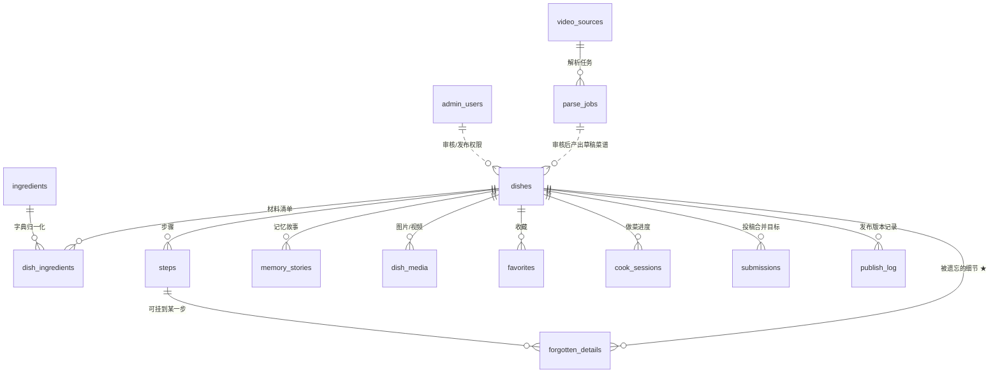

# 「记忆里的美食」数据模型设计 v1.0

| 项 | 内容 |
|---|---|
| 日期 | 2026-11-18 |
| 状态 | 设计稿，**未执行任何 DDL** |
| 配套 | `plans/记忆里的美食-主体架构方案.md` |
| 目标库 | 托管 PostgreSQL（`public` schema）；D 阶段可原样迁到自托管 PG |
| 建模原则 | 单一事实源 / 内容状态机 / 审核态不对小程序可见 / 「被遗忘的细节」独立成表 |
| 修订 | **v1.2（2026-11-18 14:32 决策落定）**，见 §13 与 `plans/记忆里的美食-架构修订说明.md` §9；v1.0 / §12 原文完整保留，§13 优先级最高 |

---

## 0. 结论先行

1. **当前原型有 12 道菜、58 个步骤，但材料 0 条、被遗忘的细节 0 条、记忆故事 0 条。** 新主体所需的核心内容资产目前全部缺失，P0 的第一项工作不是写代码，是补录内容。
2. `forgotten_details` **必须独立成表**，不能做成 `steps.tip` 字段：它需要被单独检索、精选到发现页、单独审核、单独投稿、单独统计、挂来源与置信度。做成字段就等于把产品差异点埋掉。
3. **投稿走 `submissions.payload(JSONB)` 暂存，不直接写正式表**；审核通过后才由后台归并进 `dishes/steps/…`。这样端上永远没有绕过审核的写入路径。
4. 权限分三类：公开内容（读 published / 写仅管理员）、用户数据（owner-only）、内部表（server-only，无 policy 无 grant）。
5. 小程序拉详情用**一个 RPC 聚合**，不要发 5 次请求；RLS 在函数内仍然生效。

---

## 1. 设计约定

| 约定 | 原因 |
|---|---|
| `id BIGINT GENERATED ALWAYS AS IDENTITY PRIMARY KEY` | 平台规范；避免端上生成主键 |
| `owner_id TEXT NOT NULL DEFAULT auth.uid()` | `auth.uid()` 返回 text，声明 uuid 会建表失败；owner 由服务端决定，端上 INSERT 不传 |
| `created_at / updated_at TIMESTAMPTZ NOT NULL DEFAULT now()` | 增量同步依赖 `updated_at` |
| 枚举用 `TEXT + CHECK`，不用 PG ENUM | 字典会增补（如新增「细节类型」），ALTER ENUM 成本高 |
| 只建 `public` schema 对象 | 数据面不暴露 `auth` / `pg_catalog` / `pg_*` schema |
| 一条 SQL 语句 = 一次 `exec_sql` 调用 | 平台限制：多语句会报 `cannot insert multiple commands into a prepared statement` |
| DDL 只走管理面 | 端上代码不跑 DDL；`mode: "migrate"` 执行建表/策略，`mode: "write"` 灌种子数据 |
| `SECURITY DEFINER` 只用于 `is_admin()` | 绕过 RLS 属高风险操作，实施前需按平台规则确认影响面 |

---

## 2. 实体关系



**★ 是本产品与传统菜谱库的结构差异点。**

---

## 3. 表定义（DDL 草案）

> 以下每条语句单独执行一次 `exec_sql(mode:"migrate")`。顺序按依赖排列。

### 3.1 `admin_users` — 管理员白名单（内部表）

```sql
CREATE TABLE admin_users (
  uid           TEXT PRIMARY KEY,
  display_name  TEXT,
  created_at    TIMESTAMPTZ NOT NULL DEFAULT now()
)
```

- 无 `owner_id`、无 RLS policy、不 GRANT 给 `anon`/`authenticated` → 仅管理面可写。
- 加管理员用 `exec_sql(mode:"write")` 显式 `INSERT uid`。

### 3.2 `is_admin()` — 后台写权限闸门

```sql
CREATE OR REPLACE FUNCTION is_admin()
RETURNS BOOLEAN
LANGUAGE sql STABLE SECURITY DEFINER
AS $$ SELECT EXISTS (SELECT 1 FROM admin_users WHERE uid = auth.uid()) $$
```

```sql
REVOKE EXECUTE ON FUNCTION is_admin() FROM PUBLIC
```

```sql
GRANT EXECUTE ON FUNCTION is_admin() TO authenticated, anon
```

- `SECURITY DEFINER` 让它能读 server-only 的 `admin_users`；除此之外所有业务函数保持默认 `SECURITY INVOKER`。
- 实施时按平台规则，创建/切换 `SECURITY DEFINER` 属于需确认的高风险语句。

### 3.3 `ingredients` — 材料字典（公开读）

```sql
CREATE TABLE ingredients (
  id          BIGINT GENERATED ALWAYS AS IDENTITY PRIMARY KEY,
  name        TEXT NOT NULL UNIQUE,
  aliases     TEXT[] NOT NULL DEFAULT '{}',
  category    TEXT NOT NULL DEFAULT 'other' CHECK (category IN ('main','side','seasoning','other')),
  created_at  TIMESTAMPTZ NOT NULL DEFAULT now()
)
```

- `aliases` 归一化同义词（「生抽 / 酱油」「葱 / 大葱」），是按材料反查菜谱可用的前提。

### 3.4 `dishes` — 菜谱主表

```sql
CREATE TABLE dishes (
  id               BIGINT GENERATED ALWAYS AS IDENTITY PRIMARY KEY,
  slug             TEXT NOT NULL UNIQUE,
  title            TEXT NOT NULL,
  subtitle         TEXT,
  description      TEXT,
  cover_url        TEXT,
  difficulty       TEXT NOT NULL DEFAULT 'easy' CHECK (difficulty IN ('easy','medium','hard')),
  total_minutes    INT,
  servings         INT NOT NULL DEFAULT 2,
  categories       TEXT[] NOT NULL DEFAULT '{}',
  tags             TEXT[] NOT NULL DEFAULT '{}',
  region           TEXT,
  era_decade       TEXT,
  source_type      TEXT NOT NULL DEFAULT 'editorial'
                   CHECK (source_type IN ('editorial','video_parse','user_submit','oral')),
  status           TEXT NOT NULL DEFAULT 'draft'
                   CHECK (status IN ('draft','reviewing','published','archived')),
  version          INT NOT NULL DEFAULT 1,
  rejection_reason TEXT,
  published_at     TIMESTAMPTZ,
  created_by       TEXT,
  created_at       TIMESTAMPTZ NOT NULL DEFAULT now(),
  updated_at       TIMESTAMPTZ NOT NULL DEFAULT now()
)
```

| 字段组 | 说明 |
|---|---|
| `region` / `era_decade` | 「记忆里的美食」的检索维度：地域、年代 |
| `source_type` | 区分运营整理 / 视频解析 / 用户投稿 / 家人口述，决定署名与置信度口径 |
| `status` + `version` + `published_at` | 发布与增量同步的核心；审核通过 `version+1` |
| `slug` | 稳定外链标识，不随标题改动 |

### 3.5 `dish_ingredients` — 材料清单 ★

```sql
CREATE TABLE dish_ingredients (
  id              BIGINT GENERATED ALWAYS AS IDENTITY PRIMARY KEY,
  dish_id         BIGINT NOT NULL REFERENCES dishes(id) ON DELETE CASCADE,
  ingredient_id   BIGINT REFERENCES ingredients(id) ON DELETE SET NULL,
  name_snapshot   TEXT NOT NULL,
  amount          NUMERIC(8,2),
  unit            TEXT,
  role            TEXT NOT NULL DEFAULT 'main' CHECK (role IN ('main','side','seasoning')),
  is_optional     BOOLEAN NOT NULL DEFAULT false,
  substitute_note TEXT,
  sort_order      INT NOT NULL DEFAULT 0,
  UNIQUE (dish_id, sort_order)
)
```

- `name_snapshot` 保留原文（如「少许」「一撮」），`amount/unit` 是归一化后的可计算值；两者并存才能既忠实又支持按人数换算。
- `ingredient_id` 可空：新词先入库，后台再归并字典，不阻塞录入。

### 3.6 `steps` — 步骤

```sql
CREATE TABLE steps (
  id               BIGINT GENERATED ALWAYS AS IDENTITY PRIMARY KEY,
  dish_id          BIGINT NOT NULL REFERENCES dishes(id) ON DELETE CASCADE,
  sort_order       INT NOT NULL,
  title            TEXT NOT NULL,
  description      TEXT,
  default_seconds  INT CHECK (default_seconds IS NULL OR default_seconds > 0),
  timer_enabled    BOOLEAN NOT NULL DEFAULT true,
  created_at       TIMESTAMPTZ NOT NULL DEFAULT now(),
  UNIQUE (dish_id, sort_order)
)
```

- `default_seconds` 允许 NULL：视频里常常不说时间，留空由运营补，比编一个 10 分钟更诚实。
- `timer_enabled=false` 用于「备料」「装盘」这类不需要计时的步骤；做菜模式只对需要计时的一步显示计时环。

### 3.7 `forgotten_details` — 被遗忘的做菜步骤 ★★

```sql
CREATE TABLE forgotten_details (
  id              BIGINT GENERATED ALWAYS AS IDENTITY PRIMARY KEY,
  dish_id         BIGINT NOT NULL REFERENCES dishes(id) ON DELETE CASCADE,
  step_id         BIGINT REFERENCES steps(id) ON DELETE SET NULL,
  detail_type     TEXT NOT NULL DEFAULT 'other' CHECK (detail_type IN (
                    'heat','blanch','deodorize','rest','double_fry',
                    'wok_hei','water','order','family_trick','other')),
  title           TEXT NOT NULL,
  content         TEXT NOT NULL,
  why_it_matters  TEXT,
  source_type     TEXT NOT NULL DEFAULT 'editorial'
                  CHECK (source_type IN ('editorial','video_parse','user_submit','oral')),
  confidence      NUMERIC(3,2),
  status          TEXT NOT NULL DEFAULT 'draft'
                  CHECK (status IN ('draft','reviewing','published')),
  review_note     TEXT,
  sort_order      INT NOT NULL DEFAULT 0,
  created_at      TIMESTAMPTZ NOT NULL DEFAULT now()
)
```

| 设计点 | 理由 |
|---|---|
| 独立表 + `status` | 细节可以比菜谱更早被投稿、单独精选到发现页、单独审核 |
| `detail_type` 枚举 | 火候 / 焯水 / 去腥 / 静置 / 复炸 / 锅气 / 水量 / 先后顺序 / 家里的小动作 —— 决定详情页图标与分组 |
| `step_id` 可空 | 有些细节是跨步骤的整体原则（「全程别盖锅盖」） |
| `why_it_matters` | 「不能省的那一下」的价值就在解释，不是动作本身 |
| `confidence` | 视频解析产物自带置信度，供审核排序；人工录入填 1.00 |

### 3.8 `memory_stories` — 记忆里的美食

```sql
CREATE TABLE memory_stories (
  id           BIGINT GENERATED ALWAYS AS IDENTITY PRIMARY KEY,
  dish_id      BIGINT REFERENCES dishes(id) ON DELETE SET NULL,
  owner_id     TEXT NOT NULL DEFAULT auth.uid(),
  author_name  TEXT,
  title        TEXT NOT NULL,
  body         TEXT NOT NULL,
  who          TEXT,
  scene        TEXT,
  region       TEXT,
  era_decade   TEXT,
  cover_url    TEXT,
  status       TEXT NOT NULL DEFAULT 'draft'
               CHECK (status IN ('draft','reviewing','published')),
  created_at   TIMESTAMPTZ NOT NULL DEFAULT now()
)
```

- `dish_id` 可空：允许「只有一段记忆、还没有对应菜谱」的投稿，后续再挂载。
- `owner_name` 语义同 `author_name`：登录昵称快照，端上从 session 填，不参与鉴权。

### 3.9 `submissions` — 用户投稿（审核缓冲层）

```sql
CREATE TABLE submissions (
  id            BIGINT GENERATED ALWAYS AS IDENTITY PRIMARY KEY,
  owner_id      TEXT NOT NULL DEFAULT auth.uid(),
  owner_name    TEXT,
  kind          TEXT NOT NULL CHECK (kind IN ('recipe','detail','story')),
  payload       JSONB NOT NULL,
  raw_text      TEXT,
  dish_id       BIGINT REFERENCES dishes(id) ON DELETE SET NULL,
  status        TEXT NOT NULL DEFAULT 'submitted'
                CHECK (status IN ('submitted','reviewing','accepted','rejected','merged')),
  review_note   TEXT,
  reviewed_by   TEXT,
  created_at    TIMESTAMPTZ NOT NULL DEFAULT now(),
  reviewed_at   TIMESTAMPTZ
)
```

- **端上唯一的写入口之一**：用户投稿只写这里，审核通过后再由后台拆到正式表。
- `payload` 用 JSONB 承载半结构化投稿（材料/步骤/细节/故事），避免端上直接碰 `dishes`。
- 查重：审核时按 `payload->>'title'` 与 `dishes.title` 做相似度判断，提示合并而非新建。

### 3.10 `dish_media` — 媒体

```sql
CREATE TABLE dish_media (
  id            BIGINT GENERATED ALWAYS AS IDENTITY PRIMARY KEY,
  dish_id       BIGINT NOT NULL REFERENCES dishes(id) ON DELETE CASCADE,
  kind          TEXT NOT NULL DEFAULT 'cover' CHECK (kind IN ('cover','step','result')),
  storage_path  TEXT NOT NULL,
  url           TEXT,
  attribution   TEXT,
  sort_order    INT NOT NULL DEFAULT 0,
  created_at    TIMESTAMPTZ NOT NULL DEFAULT now()
)
```

- `storage_path` 存相对路径，展示 URL 由 SDK 解析；不把签名 URL 落库（短时效、不可持久化）。

### 3.11 `favorites` / `cook_sessions` — 用户行为

```sql
CREATE TABLE favorites (
  id          BIGINT GENERATED ALWAYS AS IDENTITY PRIMARY KEY,
  owner_id    TEXT NOT NULL DEFAULT auth.uid(),
  dish_id     BIGINT NOT NULL REFERENCES dishes(id) ON DELETE CASCADE,
  created_at  TIMESTAMPTZ NOT NULL DEFAULT now(),
  UNIQUE (owner_id, dish_id)
)
```

```sql
CREATE TABLE cook_sessions (
  id           BIGINT GENERATED ALWAYS AS IDENTITY PRIMARY KEY,
  owner_id     TEXT NOT NULL DEFAULT auth.uid(),
  dish_id      BIGINT NOT NULL REFERENCES dishes(id) ON DELETE CASCADE,
  state        JSONB NOT NULL DEFAULT '{}'::jsonb,
  started_at   TIMESTAMPTZ NOT NULL DEFAULT now(),
  finished_at  TIMESTAMPTZ
)
```

- `state` 存 `{activeIdx, steps:[{remain, done, endAt}]}`，对应原型 `runtime[dishId]`；端上仍是主副本，此表用于可选的多设备续做。
- 计时以 `endAt` 时间戳为准，不依赖 JS 定时器在后台存活。

### 3.12 `video_sources` / `parse_jobs` — 解析链路（内部表）

```sql
CREATE TABLE video_sources (
  id            BIGINT GENERATED ALWAYS AS IDENTITY PRIMARY KEY,
  platform      TEXT,
  source_url    TEXT,
  author        TEXT,
  license_note  TEXT,
  media_path    TEXT,
  duration_sec  INT,
  status        TEXT NOT NULL DEFAULT 'registered'
                CHECK (status IN ('registered','stored','rejected')),
  created_by    TEXT,
  created_at    TIMESTAMPTZ NOT NULL DEFAULT now()
)
```

```sql
CREATE TABLE parse_jobs (
  id                BIGINT GENERATED ALWAYS AS IDENTITY PRIMARY KEY,
  video_source_id   BIGINT NOT NULL REFERENCES video_sources(id) ON DELETE CASCADE,
  state             TEXT NOT NULL DEFAULT 'pending' CHECK (state IN (
                      'pending','fetching','transcribing','extracting',
                      'awaiting_review','approved','failed')),
  transcript        TEXT,
  frames            JSONB,
  raw_llm_json      JSONB,
  extracted         JSONB,
  model_id          TEXT,
  confidence_avg    NUMERIC(3,2),
  error             TEXT,
  attempt           INT NOT NULL DEFAULT 0,
  created_at        TIMESTAMPTZ NOT NULL DEFAULT now(),
  updated_at        TIMESTAMPTZ NOT NULL DEFAULT now()
)
```

- **保留 `transcript` 与 `raw_llm_json` 原始产物**，失败可重试、审核可追溯，不覆盖。
- 这两张表 server-only：小程序与端上代码永不接触。

### 3.13 `publish_log` — 发布审计（内部表）

```sql
CREATE TABLE publish_log (
  id            BIGINT GENERATED ALWAYS AS IDENTITY PRIMARY KEY,
  dish_id       BIGINT NOT NULL REFERENCES dishes(id) ON DELETE CASCADE,
  from_version  INT,
  to_version    INT NOT NULL,
  action        TEXT NOT NULL CHECK (action IN ('publish','revise','archive','restore','rollback')),
  operator      TEXT,
  note          TEXT,
  created_at    TIMESTAMPTZ NOT NULL DEFAULT now()
)
```

---

## 4. 索引

```sql
CREATE INDEX idx_dishes_published ON dishes (published_at DESC) WHERE status = 'published'
```

```sql
CREATE INDEX idx_dishes_status ON dishes (status, updated_at DESC)
```

```sql
CREATE INDEX idx_dishes_tags ON dishes USING GIN (tags)
```

```sql
CREATE INDEX idx_dishes_categories ON dishes USING GIN (categories)
```

```sql
CREATE INDEX idx_di_dish ON dish_ingredients (dish_id, sort_order)
```

```sql
CREATE INDEX idx_di_ingredient ON dish_ingredients (ingredient_id)
```

```sql
CREATE INDEX idx_steps_dish ON steps (dish_id, sort_order)
```

```sql
CREATE INDEX idx_fd_dish ON forgotten_details (dish_id, status, sort_order)
```

```sql
CREATE INDEX idx_fd_type ON forgotten_details (detail_type) WHERE status = 'published'
```

```sql
CREATE INDEX idx_submissions_owner ON submissions (owner_id, created_at DESC)
```

```sql
CREATE INDEX idx_submissions_status ON submissions (status, created_at DESC)
```

```sql
CREATE INDEX idx_stories_dish ON memory_stories (dish_id, status)
```

```sql
CREATE INDEX idx_parsejobs_state ON parse_jobs (state, updated_at)
```

> 中文全文检索（菜名模糊 / 描述）先用 `ilike`；若数据量上万再评估 `pg_trgm` 或 `tsvector`，不在 P0 引入扩展依赖。

---

## 5. RLS 策略

### 5.1 三类权限矩阵

| 类型 | 表 | SELECT | INSERT / UPDATE / DELETE |
|---|---|---|---|
| I 公开内容 | `ingredients`, `dishes`, `dish_ingredients`, `steps`, `forgotten_details`, `dish_media`, `memory_stories` | `anon` + `authenticated`：仅 published（或本人草稿 / `is_admin()`） | 仅 `is_admin()`；端上禁止 |
| II 用户数据 | `submissions`, `favorites`, `cook_sessions` | 仅本人（后台 `is_admin()` 可全读） | 仅本人 own rows；`submissions` 已审核记录不允许端上改 |
| III 内部表 | `admin_users`, `video_sources`, `parse_jobs`, `publish_log` | ❌ 端上不可读 | ❌ 端上不可写，仅管理面 / 后台服务 |

### 5.2 类型 I：公开内容（以 `dishes` 为例）

```sql
ALTER TABLE dishes ENABLE ROW LEVEL SECURITY
```

```sql
GRANT SELECT, INSERT, UPDATE, DELETE ON TABLE public.dishes TO authenticated, anon
```

```sql
DROP POLICY IF EXISTS dishes_read ON dishes
```

```sql
CREATE POLICY dishes_read ON dishes FOR SELECT TO authenticated, anon
USING (status = 'published' OR is_admin())
```

```sql
DROP POLICY IF EXISTS dishes_write_admin ON dishes
```

```sql
CREATE POLICY dishes_write_admin ON dishes FOR ALL TO authenticated, anon
USING (is_admin()) WITH CHECK (is_admin())
```

子表（自身无 `status`）用 `EXISTS` 关联主表：

```sql
CREATE POLICY steps_read ON steps FOR SELECT TO authenticated, anon
USING (EXISTS (
  SELECT 1 FROM dishes d
  WHERE d.id = steps.dish_id AND (d.status = 'published' OR is_admin())
))
```

`forgotten_details` 额外要求 `status = 'published'`；`memory_stories` 额外允许 `owner_id = auth.uid()` 读自己草稿。`ingredients` 字典全量公开读、写仅管理员。

**两道闸门都要开**：缺 `GRANT` 或缺 `POLICY` 都会表现为 `42501`，排查时先分清是哪一个。

### 5.3 类型 II：用户数据（以 `submissions` 为例）

```sql
ALTER TABLE submissions ENABLE ROW LEVEL SECURITY
```

```sql
GRANT SELECT, INSERT, UPDATE ON TABLE public.submissions TO authenticated, anon
```

```sql
DROP POLICY IF EXISTS submissions_read ON submissions
```

```sql
CREATE POLICY submissions_read ON submissions FOR SELECT TO authenticated, anon
USING (owner_id = auth.uid() OR is_admin())
```

```sql
DROP POLICY IF EXISTS submissions_insert ON submissions
```

```sql
CREATE POLICY submissions_insert ON submissions FOR INSERT TO authenticated, anon
WITH CHECK (owner_id = auth.uid())
```

```sql
DROP POLICY IF EXISTS submissions_update_own ON submissions
```

```sql
CREATE POLICY submissions_update_own ON submissions FOR UPDATE TO authenticated, anon
USING (owner_id = auth.uid() AND status IN ('submitted','reviewing'))
WITH CHECK (owner_id = auth.uid())
```

> `UPDATE` 必须同时写 `USING` 和 `WITH CHECK`：只写 `USING` 会允许用户把 `owner_id` 改成别人。`favorites` / `cook_sessions` 同形，且不给端上 DELETE 需求时直接省略 DELETE policy。

### 5.4 类型 III：内部表

```sql
ALTER TABLE parse_jobs ENABLE ROW LEVEL SECURITY
```

不建 policy、不 GRANT 给 `anon`/`authenticated` → 端上完全不可达，只有管理面 `exec_sql` 与后台服务可操作。四张内部表同样处理。

---

## 6. 读模型：视图与 RPC

### 6.1 已发布摘要视图

```sql
CREATE OR REPLACE VIEW v_published_dishes AS
SELECT id, slug, title, subtitle, cover_url, difficulty, total_minutes, servings,
       categories, tags, region, era_decade, source_type, version, published_at, updated_at
FROM dishes
WHERE status = 'published'
```

- 不暴露 `rejection_reason` / `created_by` / 内部审核字段。
- 小程序列表页与增量同步基于本视图：`updated_at > last_sync_at`。

### 6.2 详情聚合（一次往返）

```sql
CREATE OR REPLACE FUNCTION get_dish_detail(p_dish_id BIGINT)
RETURNS JSONB
LANGUAGE sql STABLE SECURITY INVOKER
AS $$
  SELECT jsonb_build_object(
    'dish', (SELECT to_jsonb(d) FROM v_published_dishes d WHERE d.id = p_dish_id),
    'ingredients', COALESCE((
      SELECT jsonb_agg(to_jsonb(x) ORDER BY x.sort_order)
      FROM dish_ingredients x WHERE x.dish_id = p_dish_id), '[]'::jsonb),
    'steps', COALESCE((
      SELECT jsonb_agg(to_jsonb(x) ORDER BY x.sort_order)
      FROM steps x WHERE x.dish_id = p_dish_id), '[]'::jsonb),
    'forgotten_details', COALESCE((
      SELECT jsonb_agg(to_jsonb(x) ORDER BY x.sort_order)
      FROM forgotten_details x
      WHERE x.dish_id = p_dish_id AND x.status = 'published'), '[]'::jsonb),
    'stories', COALESCE((
      SELECT jsonb_agg(to_jsonb(x))
      FROM memory_stories x
      WHERE x.dish_id = p_dish_id AND x.status = 'published'), '[]'::jsonb),
    'media', COALESCE((
      SELECT jsonb_agg(to_jsonb(x) ORDER BY x.sort_order)
      FROM dish_media x WHERE x.dish_id = p_dish_id), '[]'::jsonb)
  )
$$
```

- 保持 `SECURITY INVOKER`：函数内的查询仍受 RLS 约束，不会绕过发布状态。
- 小程序：`cloud.database.rpc('get_dish_detail', { p_dish_id })`，详情页一次拿全三段内容。
- 未发布的 `dish_id` 返回 `dish: null`，端上按「内容不存在」处理，不显示草稿。

### 6.3 按材料反查菜谱

```sql
CREATE OR REPLACE FUNCTION search_dishes_by_ingredient(p_keyword TEXT)
RETURNS SETOF v_published_dishes
LANGUAGE sql STABLE SECURITY INVOKER
AS $$
  SELECT d.* FROM v_published_dishes d
  WHERE EXISTS (
    SELECT 1 FROM dish_ingredients di
    LEFT JOIN ingredients i ON i.id = di.ingredient_id
    WHERE di.dish_id = d.id
      AND (di.name_snapshot ILIKE '%' || p_keyword || '%'
           OR i.name ILIKE '%' || p_keyword || '%'
           OR p_keyword = ANY(i.aliases))
  )
$$
```

---

## 7. 解析输出契约（LLM → `parse_jobs.extracted`）

```json
{
  "type": "object",
  "required": ["dish_title", "ingredients", "steps", "forgotten_details", "uncertainties"],
  "properties": {
    "dish_title": { "type": "string" },
    "ingredients": {
      "type": "array",
      "items": {
        "type": "object",
        "required": ["name", "raw"],
        "properties": {
          "name": { "type": "string" },
          "amount": { "type": ["number", "null"] },
          "unit": { "type": ["string", "null"] },
          "role": { "enum": ["main", "side", "seasoning"] },
          "raw": { "type": "string" }
        }
      }
    },
    "steps": {
      "type": "array",
      "items": {
        "type": "object",
        "required": ["index", "title"],
        "properties": {
          "index": { "type": "integer" },
          "title": { "type": "string" },
          "description": { "type": "string" },
          "default_seconds": { "type": ["integer", "null"] },
          "evidence_timestamp": { "type": ["string", "null"] }
        }
      }
    },
    "forgotten_details": {
      "type": "array",
      "items": {
        "type": "object",
        "required": ["detail_type", "title", "content", "confidence"],
        "properties": {
          "detail_type": { "enum": ["heat","blanch","deodorize","rest","double_fry","wok_hei","water","order","family_trick","other"] },
          "title": { "type": "string" },
          "content": { "type": "string" },
          "why_it_matters": { "type": "string" },
          "linked_step_index": { "type": ["integer", "null"] },
          "confidence": { "type": "number", "minimum": 0, "maximum": 1 }
        }
      }
    },
    "uncertainties": {
      "type": "array",
      "items": { "type": "string" },
      "description": "模型不确定或视频未提及的项，必须列在这里而不是编造"
    }
  }
}
```

**契约里三个刻意设计**：`evidence_timestamp` 让每条结论可回溯到视频时间轴；`confidence` 让审核按置信度排序；`uncertainties` 强制模型承认不知道，避免把猜测写成材料和时长。校验不通过时任务回到 `failed` 并保留 `raw_llm_json`，绝不自动发布。

---

## 8. 种子数据迁移（原型 → 数据库）

### 8.1 现状盘点（真实数据）

| 内容 | 原型现状 | P0 目标 |
|---|---|---|
| 菜谱 | 12 道 | 12 道入库 |
| 步骤 | 58 步 | 58 步入库 |
| 材料清单 | **0 条** | 每菜 5–12 条，约 100 条，人工补录 |
| 被遗忘的细节 | **0 条** | 每菜 ≥3 条，约 36 条，人工补录 |
| 记忆故事 | **0 篇** | 先做 3–5 篇样板，验证版式 |
| 图片/媒体 | 仅 CSS 渐变色块 | 留空或用占位图，不阻塞 |

> **这是本轮架构暴露的最大问题：产品主打的两类内容（材料、遗忘细节）在现有原型里一条都没有。** 不能靠 LLM 批量编造后直接发布，P0 必须人工补录基线数据，否则产品定位无法被验证。

### 8.2 字段映射

| 原型 `DISHES` 字段 | 目标 |
|---|---|
| `id` | `dishes.slug` |
| `name` / `desc` | `dishes.title` / `dishes.description` |
| `diff` | `dishes.difficulty` |
| `cats` / `tags` | `dishes.categories` / `dishes.tags` |
| `steps[i][0]` / `[1]` / `[2]` | `steps.title` / `steps.description` / `steps.default_seconds`（`sort_order = i+1`） |
| `sum(steps[][2])` | `dishes.total_minutes`（向上取整到分钟） |
| `icon` / `g`（渐变色） | 端上展示占位，可写入 `dish_media.attribution` 备注或丢弃 |
| 无 | `dish_ingredients`、`forgotten_details`、`memory_stories` 需人工补录 |

### 8.3 迁移步骤

1. 用脚本从 `DISHES` 数组导出 `dishes.csv` / `steps.csv`（**只做数据抽取，不改原型文件**）。
2. `exec_sql(mode:"write")` 灌入 12 道菜 + 58 步，`status = 'draft'`。
3. 人工补材料与遗忘细节，逐条 `reviewing → published`。
4. 抽查 5 道菜：列表可见、详情三段齐全、按材料反查命中、`get_dish_detail` 返回结构完整。
5. 通过后再把 12 道菜批量置 `published`，`version = 1`，写 `publish_log`。

---

## 9. 状态字典

| 表.字段 | 取值 | 流转 |
|---|---|---|
| `dishes.status` | `draft / reviewing / published / archived` | 见主方案 §4.2 状态图 |
| `submissions.status` | `submitted / reviewing / accepted / rejected / merged` | 采纳后 `merged` 并记 `dish_id` |
| `forgotten_details.status` | `draft / reviewing / published` | 可独立于菜谱先审核 |
| `memory_stories.status` | `draft / reviewing / published` | 同上 |
| `parse_jobs.state` | `pending / fetching / transcribing / extracting / awaiting_review / approved / failed` | 失败保留中间产物，不覆盖 |
| `detail_type` | `heat / blanch / deodorize / rest / double_fry / wok_hei / water / order / family_trick / other` | 字典可扩充，改 CHECK 而非 ENUM |

---

## 10. 待定项（需确认后再实施）

| # | 待定 | 影响 |
|---|---|---|
| Q1 | 后台形态 A / B / D | 决定 `is_admin()` 是否需要、管理端是平台面板还是自建 Web |
| Q2 | 是否需要多设备续做 | 不需要可砍掉 `cook_sessions`，进度只留端上 |
| Q3 | `favorites` 是否 P1 上线 | 可延后到 P2 |
| Q4 | 材料字典初始规模与同义词表 | 影响按材料反查的召回 |
| Q5 | 解析任务的运行位置 | 用户已有服务器 / MinIO / 自建队列，需确定部署形态 |
| Q6 | 中文全文检索方案 | 上万条前 `ilike` 够用，之后评估 `pg_trgm` |
| Q7 | `SECURITY DEFINER` 函数确认 | 平台规定此类语句实施前需展示 SQL 与影响面并取得确认 |

---

## 11. 实施前检查清单

- [ ] 创建应用时带 `appType: "miniprogram"`（一次性、不可改）
- [ ] `publicConfig.endpoint` + `publicConfig.publishableKey` 由平台返回，不硬编码
- [ ] 每条 DDL / 策略单独一次 `exec_sql`，`mode` 分别为 `migrate` / `write`
- [ ] 建表后用 `list_tables` / `describe_table` / `list_rls` 回读确认
- [ ] 每个公开表同时具备 GRANT + POLICY，避免 `42501`
- [ ] 用真实登录用户做一次「投稿写入 → 本人读回」的往返验证
- [ ] 用未登录态验证草稿 `dish_id` 走 `get_dish_detail` 返回 `dish: null`
- [ ] 小程序 `app.json` 含 `lazyCodeLoading: "requiredComponents"`
- [ ] 代码定稿后生成 `.<applicationId>.privacy.json`
- [ ] `docs/wxamp-info.md` 加入 `.gitignore`，AppSecret 不进任何代码与文档

---

## 12. v1.1 数据模型修订（2026-11-18 竞品调研后）

> **权威说明见 `plans/记忆里的美食-架构修订说明.md`。** 本节为字段级增量；上文 v1.0 的 14 张表 DDL、索引、RLS、视图与 RPC **完整保留且有效**，本次不做破坏性变更（不 DROP、不改枚举、不改主键）。

### 12.1 增量 DDL（设计稿，尚未执行）

```sql
ALTER TABLE video_sources ADD COLUMN source_type TEXT
  CHECK (source_type IN ('user_share','operator_upload','self_made'))
```

```sql
ALTER TABLE video_sources ADD COLUMN attribution TEXT
```

```sql
ALTER TABLE parse_jobs ADD COLUMN provider TEXT
```

```sql
ALTER TABLE parse_jobs ADD COLUMN provider_job_id TEXT
```

```sql
ALTER TABLE parse_jobs ADD COLUMN raw_response JSONB
```

```sql
ALTER TABLE dishes ADD COLUMN source_url TEXT
```

```sql
ALTER TABLE dishes ADD COLUMN attribution TEXT
```

```sql
ALTER TABLE forgotten_details ADD COLUMN reject_reason TEXT
```

```sql
ALTER TABLE forgotten_details ADD CONSTRAINT fd_confidence_range
  CHECK (confidence IS NULL OR (confidence >= 0 AND confidence <= 1))
```

**用途**：`source_type` / `license_note` / `attribution` / `source_url` 支撑授权来源登记与署名（合规边界，见方案 §5.3）；`provider` / `provider_job_id` / `raw_response` 支撑「外部解析服务可切换」与原始返回留痕（方案 §11 B1）；`reject_reason` 支撑审核驳回原因记录。

### 12.2 语义重解释（不改枚举）

`parse_jobs.state` 的 `fetching / transcribing / extracting` 不再表示「我方自建管线阶段」，改为「**外部解析服务回调的阶段标记**」，由 `provider` 回调写入；`pending / awaiting_review / approved / failed` 语义不变。`transcript` 与 `raw_llm_json` 继续保留原始产物、永不覆盖；新增的 `raw_response` 存第三方原始返回，与 `raw_llm_json`（我方 LLM 输出）**分开存放**，便于区分责任归属。

### 12.3 明确不动的部分

| 对象 | 结论 |
|---|---|
| `forgotten_details` 独立表、独立 `status`、`detail_type` 枚举 | 保持不变，这是功能矩阵中唯一整列空白的核心资产 |
| `submissions.payload(JSONB)` 审核缓冲层 | 保持不变，端上永不直接写正式表 |
| `cook_sessions.state` JSONB | 保持不变，**已可容纳多菜并行状态**，§11 D1 不需要改表 |
| 三类 RLS 分权、两道闸门（GRANT + POLICY） | 保持不变 |
| `v_published_dishes` / `get_dish_detail` / `search_dishes_by_ingredient` | 保持不变；若新字段需对端上可见，再单独评估视图是否补列 |

### 12.4 新增数据规则（不改表结构，改约束与产品行为）

1. `steps.default_seconds`：视频未明确给出时长、或解析置信度低于阈值时**必须为 NULL**；禁止模型用常识猜测填充，由运营审核时补。
2. `forgotten_details`：每条入库记录须满足方案 §11 A2 的五条准入标准；`source_type` 必填；解析产物必须附 `evidence_timestamp` 与 `confidence`，模型推测内容一律进 `parse_jobs.extracted.uncertainties`，不进本表。
3. 解析产物只能落 `status = 'draft'`；经人工逐字段确认后才可进入 `published`。RLS 已保证草稿对小程序不可见（§5.2）。
4. 质量指标拆为双层：「供应商基础准确率」（第三方，用于选供应商）与「我方增量准确率」（`forgotten_details` 保留率等，属我方成绩），不得混用。

### 12.5 §10 待定项更新

Q5「解析任务的运行位置」结论更新为：**外部解析服务 + `parse_jobs` 状态表 + 回调/轮询 + 人工触发**，不自建调度系统；供应商需可切换。其余待定项不变。

---

## 13. v1.2 审核模型与权限调整（2026-11-18 14:32 决策落定）

> **权威说明见 `plans/记忆里的美食-架构修订说明.md` §9。** 本节优先级高于 v1.0 / §12 中的冲突表述。
> 决策原文：「接入；只有官方发布的才需要审核，个人用户不需要审核，审核也是内部自己审核；标准+样板+UGC」。

### 13.1 三层内容域与审核归属

| 域 | 产生者 | 可见范围 | 审核 | 承载表 |
|---|---|---|---|---|
| **A 官方公开** | 编辑 / 运营录入、外部解析产出、UGC 征集采纳 | 全体小程序用户（仅 `published`） | **内部审核（必做）** | `dishes` / `steps` / `dish_ingredients` / `forgotten_details` / `dish_media` / 官方 `memory_stories` |
| **B 个人私有** | 用户自己创建 / 导入 / 保存的菜谱与记录 | **仅本人**（RLS owner-only） | **无审核、无审核态、无 `status`** | **新增 `personal_recipes`** |
| **C 投稿通道** | 用户主动「贡献到公开菜谱」 | 本人 + 内部审核台 | 机器内容安全 + 内部审核 | `submissions`（语义收窄） |

### 13.2 新表 `personal_recipes`（设计稿，未执行）

```sql
CREATE TABLE personal_recipes (
  id           BIGINT GENERATED ALWAYS AS IDENTITY PRIMARY KEY,
  owner_id     TEXT NOT NULL DEFAULT auth.uid(),
  title        TEXT NOT NULL,
  payload      JSONB NOT NULL DEFAULT '{}'::jsonb,
  source_note  TEXT,
  created_at   TIMESTAMPTZ NOT NULL DEFAULT now(),
  updated_at   TIMESTAMPTZ NOT NULL DEFAULT now()
)
```

```sql
COMMENT ON TABLE personal_recipes IS '用户个人私有菜谱与记录，仅本人可见，无审核流程与审核状态'
```

```sql
CREATE INDEX idx_personal_recipes_owner ON personal_recipes (owner_id, updated_at DESC)
```

**设计要点**：刻意不设 `status` / `reviewed_by` / `rejection_reason` / `confidence` 等任何审核字段；`payload` 用 JSONB 承载自由结构（材料、步骤、用量、备忘、来源链接均可）；不出现在任何公开视图或 RPC 中；不参与 `get_dish_detail`。

### 13.3 RLS：owner-only 全覆盖

```sql
ALTER TABLE personal_recipes ENABLE ROW LEVEL SECURITY
```

```sql
GRANT SELECT, INSERT, UPDATE, DELETE ON TABLE public.personal_recipes TO authenticated, anon
```

```sql
DROP POLICY IF EXISTS personal_recipes_all ON personal_recipes
```

```sql
CREATE POLICY personal_recipes_all ON personal_recipes FOR ALL TO authenticated, anon
USING (owner_id = auth.uid()) WITH CHECK (owner_id = auth.uid())
```

一条 `FOR ALL` 策略同时覆盖读写，`USING` + `WITH CHECK` 都写，防止改 `owner_id` 把记录转给别人。端上 INSERT **不传 `owner_id`**，由 `DEFAULT auth.uid()` 填充。

### 13.4 `submissions` 语义收窄与增量字段

```sql
COMMENT ON TABLE submissions IS '用户主动贡献到官方公开内容库的投稿，需机器内容安全 + 内部审核；个人私有内容见 personal_recipes'
```

```sql
ALTER TABLE submissions ADD COLUMN content_check_passed BOOLEAN NOT NULL DEFAULT false
```

- `submissions` **只承载 C 域**（要进公开库的投稿）；用户随手记录进 `personal_recipes`，不进审核队列。
- `status` 状态机保留但**仅内部使用**：端上只暴露「已收到 / 已收录」两态，不展示 `reviewing / rejected` 细节。
- `content_check_passed` 记录机器内容安全结果；未通过的记录不得进入 `accepted / merged`。
- 审核台只对 `is_admin()` 开放；端上无审核入口、无社区互审、无公开审核队列。

### 13.5 明确不动

| 对象 | 结论 |
|---|---|
| 公开内容表的 `status` 状态机、`v_published_dishes`、`get_dish_detail`（只读 published） | **不变**，仍只对 A 域生效 |
| §12 的 9 条增量 DDL（`provider` / `provider_job_id` / `raw_response` / `source_type` / `attribution` / `reject_reason` 等） | **不变**，接入决策已确认，`provider` 字段为必填项 |
| 三类 RLS 框架 | **不变**；B 域是第二类「用户数据 owner-only」的延伸，不是新权限体系 |
| `forgotten_details` 独立表与独立审核 | **不变**；审核主体明确为内部运营 |
| 单库、单环境、小程序只读 published | **不变** |

### 13.6 内容安全边界（不是「审核」，是平台底线）

个人私有内容仅本人可见时不触发人工审核。但一旦提供分享卡片 / 图片 / 链接给他人，即构成公开传播，必须接入微信内容安全检测 + 举报入口。设计上 **B 域默认不提供分享入口**；若后续增加分享，需先补机器校验并把该行为纳入 C 域管理。这与「个人用户不需要审核」不冲突。

### 13.7 对 §10 待定项的影响

Q1/Q2/Q3 已拍板（解析接入、审核模型、标准+样板+UGC）；Q5 已由 §12.5 定稿（外部解析 + 状态表，不自建调度）；Q4（多设备续做）、Q6（中文全文检索）、Q7（`SECURITY DEFINER` 确认）保持不变。

> v1.2 仍**未执行任何 DDL**，未开通云服务、未写代码、未发布、未改动原型 HTML。
